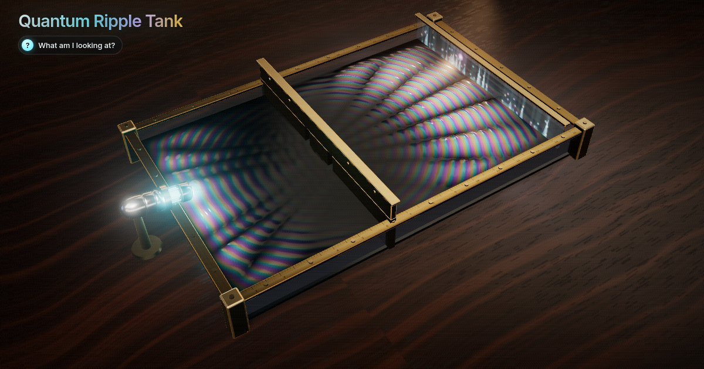

# Quantum Ripple Tank

Fire an electron at a brass double slit and watch its wave go through both slits at once and paint interference stripes, or tunnel through a wall, live in 3D from Schrodinger's equation.



**Live demo:** https://interesting-x.scorpion-labs.com/quantum-ripple/

Inspired by a bookmark from [@mathemetica](https://x.com/mathemetica/status/2111838308246671613).

Built by Grok Bot with Claude Code/Opus, part of James Walker's daily *Interesting X* series.

## Run locally

```bash
npm install
npm run dev      # then open the printed URL (served under /quantum-ripple/)
npm run build    # static output in dist/
```

## Notes


A liquid-glass ripple tank on a walnut desk (three.js) running the **2D time-dependent
Schrödinger equation** live: an electron wave packet leaves an aluminium gun, hits a brass
double slit and paints interference stripes, or tunnels through a thin wall. Inspired by
[@mathemetica](https://x.com/mathemetica/status/2111838308246671613)'s "Four equations"
post (Schrödinger, Maxwell, Einstein, Dirac); this brings the first one to life.

```
i ∂ψ/∂t = −½ ∇²ψ + V ψ        (ħ = m = 1)
ψ ← e^{−iV dt/2} · F⁻¹[ e^{−i k² dt/2} · F[ e^{−iV dt/2} ψ ] ]      (split-step Fourier)
```

- Grid 256 × 128 (dx = 1, dy = 1.25, so the tank is 1.6 : 1), periodic, dt = 0.5, radix-2 FFT in
  JS (Float64, row-vectorised column passes). Strang splitting, unitary up to round-off.
- Edges: complex absorbing potential (V − iW, W = γ s²); the right absorber is the
  detector screen, and the probability it eats per row is the arrival distribution.
- Barrier: anti-aliased hard wall (V = 6 ≫ E) with real gaps for the slits; tunnel wall:
  finite V₀ and thickness a (default V₀ = 0.6, a = 2, E = k₀²/2 = 0.405 → ~24 % tunnels).
- Packet: ψ = exp(−|r − r₀|²/4σ²) e^{i k₀ x}, normalised. Energy slider sets k₀ ∈ [0.6, 1.3].
- Display: height ∝ |ψ| (exposure per side of the barrier, plus a small Re ψ ripple),
  colour = arg ψ on a teal → violet → magenta → amber wheel, glow ∝ density.
- Auto-fire: each visible wave stands for a batch of electrons; dots are sampled one at a
  time from the arriving probability (Tonomura-style build-up). Single Fire = one electron:
  one dot with probability equal to what reached the screen, else "bounced back".

## Run

```bash
npm run dev      # http://127.0.0.1:43147/quantum-ripple/
```

- `?renderer=2d` forces the Canvas2D fallback (also used automatically if WebGL init fails or the context is lost).
- `?intro=0` skips the intro card; `?record=1` is the recorder mode (no intro, no gallery nav).
- `window.__quantumInfo()` → `{ renderer, grid, norm, transmitted, mode, k0, frames, fps, … }`
- `window.__quantumSelfTest()` → headless physics check `{ norm, fringe: { measured, predicted, ratio }, tunnel: { thin, thick }, pass }`:
  norm drift < 1e-3 without absorber, fringe spacing within 15 % of λL/d, thin wall transmits more than thick.
- `record.json` uses deterministic `"capture": "frames"` (via `window.__ixRecord.stepFrame`); the plan is ~18 s: `npm run record -- quantum-ripple --seconds 18`. Note the recorder also rewrites `public/og.png` from a 1 s warm-up frame; the committed OG is a hand-picked frame with the fringes fully fanned out.

## Files

| File | Role |
|------|------|
| `src/engine.ts` | Split-step Fourier TDSE solver, FFT, potentials, absorber bookkeeping, self-test |
| `src/sim.ts` | Firing, auto-fire, detector dots + histogram, measurement/collapse, taps, shot stages |
| `src/scene3d.ts` | three.js scene: displaced water (vertex texture fetch), brass, glass, gun, screen, bloom, ACES |
| `src/scene2d.ts` | Canvas2D fallback (top-down) |
| `src/main.ts` | UI, pointer input (tap water / drag barrier / orbit), live caption, plots, test hooks |

## License

MIT © 2026 James Walker
